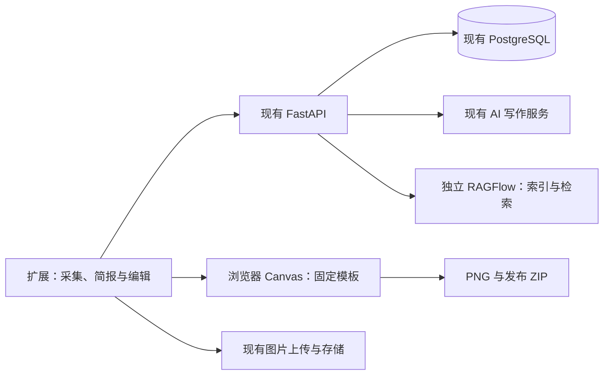

# xhs_tool 一期方案：个人图文创作闭环

设计日期：2026-10-16。状态：已于 2026-10-17 在本地功能分支实现，尚未部署或推送。实际交付及验证边界见[验证记录](../../verification.md)和[使用指南](../../creator-workbench.md)。

## 1. 目标与取舍

让个人创作者在同一份内容中完成“记录选题 → 找素材 → 写作 → 制图 → 准备发布 → 记录效果”，减少复制、重复输入和素材失联。

沿用 Chrome 扩展、React、FastAPI、PostgreSQL 和已有图片存储。保留“采集、素材库、创作、发布”四个入口；窄侧栏使用列表和分区，全页模式提供更宽的编辑与预览区域。

采用最小实现：

- **草稿就是选题记录**，只增加 `idea` 状态，不另建选题表或任务系统。
- **每人一份创作档案**，每篇一份简报；不做多品牌、多账号管理。
- **RAGFlow 只负责索引和检索**，AI 写作仍走现有接口；不同时接入其他知识库框架。
- **两套固定图文模板**，通过文字、顺序和配色调整，不做自由画布。
- **排期和复盘从手动录入做起**，不做自动发布、平台数据抓取或后台通知。

覆盖六项能力，每项只交付能接通前后环节的版本。下文保留原始设计；实际字段、接口和取舍以代码与验证记录为准。

## 2. 一期交付范围

| 能力 | 一期实现 | 完成标准 |
| --- | --- | --- |
| 选题工作台 | 复用草稿，支持选题、创作中、待发布、已发布；主题标签、计划日期、关联素材 | 只填写题目即可保存选题，之后在原记录继续写作 |
| 素材与 RAG | 已采集素材建立索引，按问题或简报检索，显示来源与原文片段 | 提纲和正文建议可追溯到本人素材；无结果时明确提示 |
| 创作档案与简报 | 定位、受众、语气、禁用表达、最多三篇风格参考；单篇目标、观点、依据、行动引导 | 一次填写档案，写作时选用；单篇允许覆盖 |
| 图文制作 | 清单、步骤两套模板，各含封面和正文卡；分页预览、文字调整、排序、PNG 导出 | 同一篇正文可生成一组顺序明确、文字无截断的图片 |
| 发布准备 | 按日期查看待发布内容，检查和预览，导出 ZIP，登记实际链接与发布时间 | 导出内容与所记录的草稿版本一致，能再次查看发布时内容 |
| 内容复盘 | 手动或约定 CSV 导入指标，按主题和模板比较，生成复盘建议 | 能看到相近观察时长的数据，并把建议转为新选题 |

计划日期只是个人安排，不表示平台已经预约发布。第一期提醒只在工具内显示“今日待发布、已逾期、待补数据”。

## 3. 页面与操作路径

**采集、素材库**：保持现有采集和标签操作，增加索引状态、建立索引、重试、查看引用。第一次启用时明确说明：所选素材正文会解密后发送给自托管后端，再写入配置的 RAGFlow 实例。已有素材支持分批补建；后续新采集素材在启用该选项后随保存同步。

**创作**：顶部为状态筛选和选题列表；进入一条记录后依次是“简报、写作、图文”。沿用现有编辑器、图片选择、AI 建议区、应用与撤销操作。已有草稿直接进入“创作中”，不强制补填简报；没有计划日期也能创作。

**发布**：增加一周日期列表和未排期列表，使用原生日期控件改期。单篇展示发布预览、导出、登记链接；已发布内容进入指标和复盘。先做列表，不引入日历或拖拽库。

**设置**：增加个人创作档案和 RAG 服务状态。RAG 服务地址、密钥、数据集绑定由后端管理，浏览器不保存服务管理密钥。

## 4. 最小架构

后端复用已有 `httpx` 调用 RAGFlow，只实现一个具体集成模块。第一期不引入 LangChain、LlamaIndex、向量数据库、Redis 或任务队列。解析任务交给 RAGFlow；前端打开页面时查询进度，失败可重试。

部署假设：已有或单独部署一个可访问的 RAGFlow HTTP 服务，优先在 Linux 主机部署；本地 Mac 仍可使用扩展。服务部署和模型资源消耗单独验收，不要求把 RAGFlow 塞进现有后端进程。关闭 RAG 时，现有采集、编辑和导出继续可用。

## 5. 数据改动与兼容

| 位置 | 最小改动 | 约束 |
| --- | --- | --- |
| `users` | 加密创作档案、档案版本号 | 一人一份；保存带预期版本，冲突不能静默覆盖 |
| `drafts` | `status` 增加 `idea`；增加 `planned_date`、`topic_tags`、`encrypted_context` | 保留原有正文加密格式和乐观锁；日期、标签、状态是可查询元数据 |
| 草稿加密上下文 | 格式版本、单篇简报、采用的风格快照、引用快照、卡片参数和人工修改后的卡片文字 | 使用独立随机 IV；与标题、正文一起纳入保存、冲突副本和本地恢复 |
| `material_rag_indexes`，唯一新增业务表 | 所属用户、素材 ID、内容哈希、索引配置版本、数据集/文档 ID、状态和错误 | 外部文档绑定不接受客户端任意指定；待清理绑定不能随素材硬删除而丢失 |
| `published_posts` | 写入已有加密快照字段；补充主题标签、模板 ID、草稿版本、图片 ID 列表；允许填写实际发布时间 | 标签和模板快照用于复盘；已发布快照不随草稿后续修改而变化 |
| `post_analytics` | 复用现有五项指标与观察时间 | 浏览、点赞、评论、分享、收藏为非负累计数；不能把增量数混入 |

现有 `material_id` 继续兼容单素材来源，多素材引用保存在加密上下文。引用包含素材 ID、来源标题/链接、引用原文和内容哈希；素材失效后仍保留历史依据，并标记原素材已不可访问。

**保存规则必须同时修改**：

- `idea` 允许“有题目、正文为空”，正文仍以密文保存；进入待发布前检查实际内容。
- 普通正文保存不能把已有状态、计划日期或上下文重置为默认值。新增可选字段区分“未提供”和“明确清空”。
- 所有内容变化继续使用 `expected_version`，409 冲突保留本地副本；切换账号、密钥或后端时延续现有隔离规则。
- 老数据的上下文为空、计划日期为空、标签为空时仍能打开、保存和导出。不得重写无法解密的旧密文。

标题、正文、档案和简报继续加密存储。用户已接受的明文范围是用于 RAG 的素材副本，以及执行 AI 请求时所需的文本；主密钥不发送给后端。RAG 服务若使用外部模型，发送范围需要在启用时说明，不能默认把整库交给第三方。

## 6. RAG：先把素材用于写作

### 建立与更新索引

1. 浏览器在解锁后读取素材全文，连同素材 ID、内容哈希发送给本项目后端。
2. 后端校验所属用户、大小和哈希，生成 TXT/Markdown 上传到该用户绑定的数据集，不重新抓取原网址。
3. 调用 RAGFlow 解析接口并记录文档绑定；页面查询解析状态，成功后显示可检索。
4. 相同内容和索引配置不重复建立索引；内容、嵌入模型或解析配置改变时重新索引，旧绑定待清理。

上传失败后可能需要浏览器重新解锁并重传全文；不承诺浏览器关闭后本项目自动重试。RAGFlow 已接受的解析任务可以在其服务端继续运行。

上传响应丢失时，按包含素材 ID 和内容哈希的确定性文档名核对远端，避免重复上传。文档名只用于核对，不作为权限证明。

### 检索与生成

1. 用简报主题、读者问题和当前写作要求形成查询；允许限定所选素材。
2. 后端只检索当前用户的数据集，并校验返回文档仍绑定到有效素材和当前内容版本。生成请求只接受来源标识和选择结果，引用原文由后端从有效检索结果取得，不直接信任客户端回传的片段正文。
3. 初始最多使用六个片段、总计最多 8,000 字符，并按实际模型输入预算进一步截断；这些是默认上限，不是效果保证。
4. 浏览器展示来源卡片；用户可排除片段。AI 生成提纲或正文建议，引用标记只能使用本次检索得到的来源编号。
5. 采用建议时一起保存引用快照；正文后续手工修改后，引用需允许复核和移除，不能继续标为“已验证”。

检索材料作为引用数据处理，不执行其中的指令。无结果、服务失败或索引未完成时给出明确状态；用户可继续普通写作，但不生成虚假的引用。生成建议沿用现有流式展示、取消、明确应用和撤销。

### 删除与错误处理

素材删除或撤销索引时先从可检索集合排除，再删除远端文档。远端失败保留文档 ID 和待清理状态，下次打开管理页可重试；界面显示“远端清理未完成”。即使远端仍返回片段，生成接口也必须过滤失效绑定。

按明确文档 ID 删除，禁止空列表变成整库删除。所有请求同时校验 HTTP 状态和 RAGFlow 业务返回码。接口、解析器标识和部署镜像固定到联调通过的版本，不跟随 `latest`；此前调研的 `v1.0.0-rc2` 仅作为联调候选，不视为已验证兼容。

## 7. 图文与发布：固定模板足够完成第一版

第一期模板只有“清单”和“步骤”，共用封面布局。默认导出 1080 × 1440 像素，这是产品预设，不宣称是平台唯一规格。支持标题、段落、列表、序号和一张配图；复杂 Markdown 内容按受支持的文本结构转换并预览。

使用原生 Canvas 测量文字、换行和分页；等待字体加载后导出，超长标题、长英文和表情均需验证。用户可修改每张卡片文字、拆页、调整顺序和选择少量预设配色，不支持任意 HTML、脚本或自由拖拽画布。

卡片参数与人工修改随草稿加密保存，多设备可重新生成。纯文字卡片在本地直接导出；需要长期保存生成图片时复用现有上传流程。配图沿用已授权下载地址，并验证跨域加载和失效后的重试。

发布包包含 `title.txt`、`content.txt`、`sources.md` 和按顺序命名的 PNG。为可靠生成单个 ZIP，新增一个小型库 `fflate`；不手写 ZIP，也不引入截图或画布框架。图片下载失败、渲染失败或总文件体积超过默认 100 MB 时明确报错，不能把不完整包显示为导出成功。

导出前冻结已保存草稿的版本；后续修改时提示发布包已过期。检查项包括标题和正文是否为空、卡片文字是否溢出、图片是否缺失、引用是否需复核；平台字数限制如加入校验，需注明规则来源和核对日期。

登记发布时，浏览器提交该版本的加密发布快照、实际链接和实际发布时间。后端锁定本人草稿、核对版本并写入快照，再更新状态；重复登记同一链接返回原记录。幂等重试先识别原记录，不能因首次登记已增加版本号而误报冲突。以后修改或删除草稿，仍可查看这次发布的内容与指标。

快照保留标题、正文、引用和卡片参数；配图 ID 同时保存到发布记录并校验所属用户。仍被发布记录引用的图片不能直接删除，避免出现文字还在、配图消失的历史记录。导出的 ZIP 是用户可独立保留的发布产物。

## 8. 复盘：先让数据可比较

支持手动录入和项目约定的 CSV：发布链接、观察时间、浏览、点赞、评论、分享、收藏。CSV 只是本工具导入格式，不承诺直接兼容平台导出的任意文件。后端使用标准库解析，默认单次最多 500 行；先预览校验结果，再确认导入，有错误则整批不写入。

观察时间与实际发布时间统一保存带时区的时间，按用户本地时间展示。拒绝负数、未知发布记录、越权记录和早于发布时间的观察时间；同一发布记录、同一观察时间的重复导入应跳过或明确报告冲突。

先做三个视图：单篇指标历史、主题比较、模板比较。比较时显示样本数和实际观察时长；没有对应 24/72 小时观察点就标为缺数据，不把最新累计值当作该时点数据。零浏览时比率为空，不能产生无穷值。

复盘建议分为“数据观察”和“下一步尝试”，可引用具体内容及指标，用户选中后创建新的 `idea` 草稿。样本少时明确展示不足；不做因果归因、爆款评分或自动 A/B 结论。没有曝光和点击字段，不输出点击率。

## 9. 接口与代码落点

| 改动 | 拟采用路径或位置 |
| --- | --- |
| 创作档案 | 新增 `GET/PUT /profile`，沿用认证与版本冲突规则 |
| 选题与排期 | 扩展现有 `/drafts`；更新 `drafts.ts`、`useDraftEditor.ts` 的加密、签名、恢复和保存逻辑 |
| RAG | 新增 `/materials/{id}/rag` 的状态、同步和撤销操作，以及 `/rag/retrieve`；后端固定一个 RAGFlow 调用模块 |
| AI 写作 | 扩展现有 AI 请求，携带简报、风格和经后端核验的检索结果；检索结果不是客户端授权凭据 |
| 图文与导出 | 创作页中新增固定模板预览；发布页复用预览和统一导出函数 |
| 发布记录 | 扩展 `POST /publish/records`，写入已有快照字段并校验草稿版本 |
| 指标与复盘 | 扩展现有指标接口的观察时间，增加导入预览/确认与统计接口 |
| 备份 | 扩展现有 `backup.ts` 和 `/backup`、`/backup/restore`，不导出完整 `users` 表 |

没有必要为这些能力创建统一工作流引擎、事件总线或通用 AI Provider 层。复用当前状态管理、数据请求和认证方式，按现有文件结构增加代码。

## 10. 备份与迁移是交付内容

当前备份没有创作档案；恢复类型解析也不支持拟增加的日期和 JSON 对象。不能仅添加数据库字段就宣称备份已兼容。

- 保持现有密码加密外壳，新增内部载荷/记录 v2；新版读取器同时接受 v1，缺失字段按旧数据语义补齐。旧客户端必须明确拒绝不支持的新版备份。
- 备份包括创作档案、草稿上下文、计划日期、发布快照和指标；不包含账户凭证、RAGFlow 密钥。原有图片备份能力边界仍需明确，不能把图片元数据当成文件本身。
- 恢复继续执行所属用户校验、事务和不覆盖已有记录的约束；补充加密信封、日期和字段大小校验。
- 服务端恢复返回 ID 映射后，浏览器解密并修正上下文中的素材引用，再加密保存；修正中断时保留原上下文和待修复状态，不丢弃引用文字。
- RAG 外部数据集/文档 ID 不直接恢复到新实例。恢复后显示待重建索引，由解锁的浏览器重新同步；RAGFlow 自身数据备份另行管理。
- 迁移使用新增可空字段和默认值，不批量解密旧数据。开发与验证使用隔离数据库，不直接迁移现有使用中的实例。

## 11. 分三批落地

| 顺序 | 交付 | 验收门槛 |
| --- | --- | --- |
| A：先接通内容记录 | 选题、档案、简报、状态和日期；备份 v2 基础支持 | 空正文选题可保存、跨设备重新打开；旧草稿可用；冲突和恢复不丢新字段 |
| B：再接通创作产物 | RAG 索引/检索/引用，两套卡片模板、ZIP、发布快照 | 一份本人素材可生成带依据的建议；完整导出可用；发布后仍能查看当时内容 |
| C：最后接通反馈 | 排期列表、指标输入/CSV、统计与复盘转选题 | 导入可重复核验；比较标明时长与样本数；复盘可回到新的选题 |

每批先完成对应迁移、恢复和权限验证，再进入下一批。不按缺少依据的天数承诺工期；A 完成后依据实际改动量估计 B/C。

## 12. 验证与一期验收

在已有测试基础上增加有意义的行为验证：

- **兼容与恢复**：旧草稿/旧备份；新字段保存后重新打开；错误密钥与损坏数据；并发保存；离线恢复；账号或后端切换；恢复 ID 改变与修复中断。
- **RAG**：重复上传、解析失败、响应丢失、内容更新、服务不可用、跨用户访问、失效引用、删除远端失败及重试；引用必须来自本次有效检索。
- **制图与导出**：中文、长标题、长英文、表情、跨页、图片跨域/失效、字体加载、体积超限、下载部分失败；解压后文字与图片顺序对应。
- **发布与复盘**：版本变化阻止登记、重复登记幂等、草稿删除后快照仍在；CSV 越权/错误不部分导入；观察时间、重复数据、零分母与样本不足。

端到端验收用一个固定的小样本：约 20 条自有素材、三条选题、两篇完整图文、至少两次指标观察。预先列出可回答和不可回答的问题，核对检索、引用、删除和导出结果；这是功能验收，不是公开检索效果基准。

自动检查覆盖后端测试、前端类型/构建和必要的交互测试。人工分别检查约 390px 侧栏和全页界面。真实 RAGFlow、实际 AI 提供方、浏览器图片渲染和平台手动发布单独记录结果，不能用模拟接口测试替代。

一期交付完成的标志：**一条选题能够带着素材依据、简报、图片、发布快照和后续指标走完整个闭环，且旧数据仍能安全读取与恢复。**

## 13. 暂不增加，何时再考虑

| 暂缓项 | 再考虑的触发条件 |
| --- | --- |
| 自由画布、更多模板、AI 生图 | 固定模板确实无法覆盖持续使用的版式需求 |
| GraphRAG、多知识库引擎、自动选模型 | 小样本证明现有检索不足，且有可重复的失败案例 |
| 本项目后台队列和定时重试 | 必须在浏览器关闭后完成上传，或出现持续的大批量任务 |
| 自动发布、平台抓取、多账号协作 | 有可用且合适的官方接口、明确授权和实际使用需求 |
| 自动运营评分、趋势预测 | 有足量、口径一致的数据和可验证的评估方法 |

## 14. 依据与验证边界

本方案根据当前工作树 `7e3590d8a9f118062dd090f2e5dc776770e7b380` 的草稿、加密、发布、指标和备份实现整理。尤其需要补齐：选题空正文无法保存、普通保存可能重置状态、发布快照字段未写入、新字段与备份类型不兼容。

相关代码：[`draft.py`](../../../backend/app/models/draft.py)、[`drafts.py`](../../../backend/app/routers/drafts.py)、[`useDraftEditor.ts`](../../../extension/src/sidepanel/hooks/useDraftEditor.ts)、[`publish.py`](../../../backend/app/routers/publish.py)、[`backup.py`](../../../backend/app/routers/backup.py)、[`backup.ts`](../../../extension/src/sidepanel/lib/backup.ts)。

参考的是公开功能和官方接口资料，未进行付费产品实测，也未完成本项目 RAGFlow 联调：

- [RAGFlow 项目](https://github.com/infiniflow/ragflow)与 [v1.0.0-rc2 HTTP API 参考](https://github.com/infiniflow/ragflow/blob/v1.0.0-rc2/docs/references/http_api_reference.md)：独立索引、检索与文档管理服务。
- [Buffer Create](https://buffer.com/create)：选题收集与内容准备的产品参考。
- [Jasper Brand Voice](https://www.jasper.ai/brand-voice)：个人风格输入的产品参考。
- [MD2Card](https://md2card.com/en)：固定主题、分页图文的产品参考。
